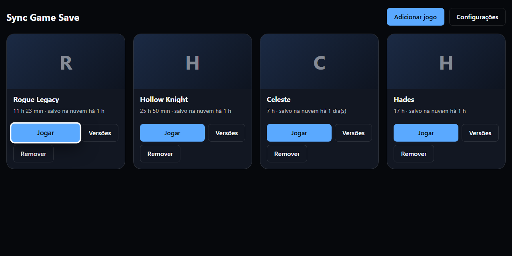

# sync-game-save

Launcher/HUB de jogos para PC que sincroniza o save com uma pasta de nuvem (OneDrive, Google Drive etc.) ao abrir e ao fechar cada jogo, sem perder saves.



## Estado

Em desenvolvimento com Wails v3 (Go) + React (ver [plano de migração](docs/plans/migracao-wails.md), [ADR 0008](docs/adr/0008-stack-wails-go.md) e a [arquitetura](docs/architecture.md)). O backend Go tem o núcleo de sync (`internal/core`), o catálogo (`internal/catalog`), a biblioteca local (`internal/library`), as conquistas (`internal/achievements`), o controle (`internal/gamepad`), a CLI `sgs` (`cmd/sgs`) e os serviços do app (`app_*.go`). As telas: primeiro uso, Início (arte do jogo em destaque e faixa de jogos por seção), Biblioteca em grade de capas com busca, filtros e ordenação, adicionar jogo, conquistas do jogo e do HUB, versões, conflito, configurações e Sobre. Os sons da interface são sintetizados em `src/som.ts`.

As artes de cada jogo (capa, fundo, logo e capa vertical) vêm da Steam CDN. Quando o catálogo não conhece o jogo, o app procura o nome na loja da Steam. Sem arte, o app mostra as iniciais do jogo sobre uma cor. As conquistas da Steam usam a conta da Steam instalada neste PC e o perfil público, sem chave de API; o perfil precisa mostrar os detalhes dos jogos como públicos. Os temas trocam as cores e medidas da interface; o app traz o escuro (padrão) e o claro. A tela de adicionar jogo permite procurar jogos em uma pasta, revisar os resultados e selecionar os caminhos de save antes de adicioná-los. Depois de adicionar cada jogo, o app guarda a primeira cópia do save na pasta de sincronização, sem abrir o jogo. Ele recusa se o jogo estiver aberto ou se outro PC estiver jogando, e nunca restaura nem troca uma versão que já exista: nesse caso, a escolha fica para quando você abrir o jogo.

A Central rápida (tecla F1 ou R3 no controle) mostra o estado real de cada jogo, envia os saves que mudaram neste PC (“Sincronizar tudo agora”, sem restaurar nem trocar versões), ajusta o volume e fecha o app, só quando nenhum jogo está aberto ou sincronizando.

Na tela de adicionar jogo, quando o catálogo não indica onde o jogo salva, o botão “Descobrir onde o jogo salva” abre o jogo, espera ele fechar e lista as pastas com arquivos novos ou alterados, ignorando caches e logs. O caminho só entra no jogo após a sua confirmação; nada é salvo por conta própria.

No Windows, ao parar um jogo o app pede que ele feche normalmente. Se continuar aberto após 10 segundos, é possível confirmar o fechamento forçado, que pode danificar o save. O sync espera o grupo de processos terminar e verifica se os arquivos pararam de mudar antes de criar uma nova versão.

## Conquistas do HUB

Em **Meu progresso**, o app mostra marcos válidos para qualquer jogo: horas jogadas, jogos na biblioteca, sequência de sincronizações concluídas sem erro e jogos com todas as conquistas da Steam desbloqueadas. O progresso é calculado da biblioteca local e do cache de conquistas; a sequência atual zera quando uma sincronização falha, e o melhor resultado fica guardado.

## Capas

As capas são baixadas uma vez e ficam no cache local (`art` na pasta de dados do app). A Steam é a primeira fonte. Para os demais jogos, o SteamGridDB é consultado pelo nome quando há uma chave configurada em Configurações → Capas dos jogos. A chave fica só neste PC, no banco local, e nunca volta para a tela.

## Temas

Para instalar um tema, crie `themes/<id>/theme.json` na pasta de dados do app (`%APPDATA%\com.syncgamesave.app\themes` no Windows; `SGS_DATA_DIR` troca a pasta) e escolha o tema em Configurações → Tema:

```json
{
  "name": "Meu tema",
  "author": "Seu nome",
  "version": "1.0.0",
  "min_app_version": "0.1.0",
  "tokens": {
    "--sgs-bg": "#101820",
    "--sgs-text": "#f5f7fa"
  }
}
```

Só os tokens `--sgs-*` (listados em `src/tokens.css`) são aplicados. Nenhum CSS ou JavaScript do tema é executado, e valores com `url()`, `@` ou `;` são recusados. Temas com `min_app_version` maior que a versão do app são ignorados.

## Distribuição

O app é distribuído em [releases no GitHub](https://github.com/dougkusanagi/sync-game-save/releases): instalador NSIS para Windows (português do Brasil, instalação por usuário em `%LOCALAPPDATA%`) e AppImage para Linux (GTK4). Ao abrir, o app procura uma versão nova e mostra o aviso; a instalação fica em Configurações → Sobre.

Cada jogo aberto grava o resultado do sync em `logs/sync-AAAA-MM-DD.log`, dentro da pasta de dados do app (arquivos com mais de 30 dias são apagados). Configurações → Sobre → "Abrir pasta dos registros" abre essa pasta. A central rápida (F1) mostra os avisos recentes e, com um jogo aberto, o botão "Voltar ao jogo" (Windows).

```bash
wails3 package   # Windows: bin/sync-game-save-amd64-installer.exe (o makensis precisa estar no PATH)
```

A atualização usa um manifesto assinado com Ed25519 (`latest-wails.json`, [ADR 0009](docs/adr/0009-atualizador-wails-manifesto-assinado.md)). A chave pública fica em `build/updater-public.pem`; a privada fica fora do repositório. Para cada release:

```bash
go run ./cmd/assinar manifesto --chave <privada.pem> --versao X.Y.Z --arquivo bin/sync-game-save.exe --url <url do executável no release> --saida latest-wails.json
```

## Protótipo da interface

```bash
cd prototype
bun install
bun run dev
```

Abra `http://localhost:5199`. Detalhes em [prototype/README.md](prototype/README.md).

## Rodar o app e testar

É preciso ter Go, bun e o CLI do Wails (`go install github.com/wailsapp/wails/v3/cmd/wails3@latest`).

```bash
bun install
wails3 dev                 # app Wails + React com recarga
go test ./...              # núcleo, catálogo, biblioteca, conquistas, CLI e serviços do app
bun run e2e                # testes E2E da interface (dados simulados)
bun run e2e:wails          # Windows: app Wails real em WebView2, com a janela fora da tela (SGS_E2E_VISIVEL=1 mostra)
```

`SGS_DATA_DIR` troca a pasta de dados do app (útil para testes sem mexer na sua biblioteca). Na primeira vez, instale o navegador dos testes E2E com `bunx playwright install chromium`. A interface também abre no navegador (`bun run dev`, `http://localhost:1420/?cenario=jogos`) com dados simulados; os cenários são `jogos`, `vazio`, `primeiro-uso`, `conflito` e `preview` (com arte, usado na miniatura do README).

Os arquivos de `internal/testdata/rust` foram gerados pela versão Rust (ver o README da pasta) e garantem que o app Go lê os dados de quem já usa a v1.x.

## CLI `sgs`

```bash
go run ./cmd/sgs help
go run ./cmd/sgs run --sync-dir <pasta da nuvem> --game "Nome" --save-dir <pasta do save> -- <jogo.exe>
```

O `run` sincroniza antes de abrir, abre o programa, espera ele fechar e envia o save. Uma queda ou um erro do jogo não perde o save: o formato da pasta da nuvem está no [ADR 0003](docs/adr/0003-formato-da-pasta-da-nuvem.md).
