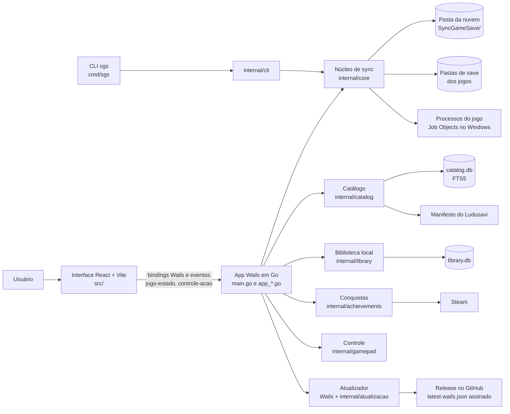

# Arquitetura

O Sync Game Save é um app de desktop (Windows; Linux a definir) que guarda e sincroniza os saves dos jogos com uma pasta de nuvem (OneDrive, Google Drive etc.). Ele não tem servidor próprio: a nuvem é só uma pasta comum, e a única conexão de rede do app é para a Steam, o catálogo de jogos e as atualizações.

## Componentes

- **Interface** (`src/`): React + TypeScript + Vite, em português. Toda a ponte com o backend está em `src/api.ts`. Fora do app (navegador, testes), `src/mock` simula os dados.
- **App Wails** (`main.go`, `app_*.go`): expõe os serviços à interface (jogar, parar, versões, catálogo, varredura, primeiro backup, temas, conquistas, atualização), a bandeja, as notificações, o controle e o servidor de capas locais (`/capa/`, restrito à pasta `art`).
- **Núcleo de sync** (`internal/core`): caminhos portáteis com marcadores, índice e decisão em três vias, snapshots, trava com heartbeat, diário de operações, acompanhamento e parada dos processos do jogo, descoberta de pastas de save.
- **Catálogo** (`internal/catalog`): converte o manifesto do Ludusavi em SQLite com FTS5; reconhece pastas de jogos e varre bibliotecas.
- **Biblioteca** (`internal/library`): `library.db` deste PC (jogos, configurações, tempo jogado, cache de conquistas). Fica fora da pasta da nuvem.
- **Conquistas** (`internal/achievements`): provedores da Steam (perfil público ou chave de API) e cálculo de raridade.
- **Controle** (`internal/gamepad`): botões viram as mesmas ações do teclado; leitura por XInput no Windows.
- **Atualização** (`internal/atualizacao`, `cmd/assinar`): manifesto assinado com Ed25519 que o atualizador do Wails confere antes de trocar o executável.
- **CLI** (`internal/cli`, `cmd/sgs`): o mesmo núcleo, sem interface.

## Dados que o usuário já tem

O app lê e grava os mesmos arquivos da versão anterior (Tauri/Rust): `library.db`, `catalog.db`, a pasta `state/`, a pasta `SyncGameSave/` na nuvem e a pasta de dados `%APPDATA%\com.syncgamesave.app`. Os testes em `internal/testdata/rust` confirmam essa compatibilidade.

## Decisões

Veja `docs/adr/`.
